# EVENT HORIZON: MARS

**Build. Survive. Research. Explore.** · *Бүтээ. Амьд үл. Судал. Нээ.*

A science-driven Mars colony game by **Tariatiin Eserguu**, made in Unity 6 for the **2026 NASA Hackathon**.
Fully playable in **English** and **Mongolian (Монгол хэл)**.

It is the year 2189. You are an aerospace systems engineer arriving at ARES-1, humanity's largest settlement on
Mars. You are not a hero, just the specialist who keeps a fragile civilisation alive. Then an old research station
goes silent, records go missing, and an orbital telescope sees starlight bending around something that isn't there.
Eighteen years ago, an expedition called PROJECT HORIZON vanished chasing the same signal.

Every colony system runs on real physics and published mission data. The mystery is solved with science, not
weapons: you measure, calculate and reason your way to the truth.


---

## Contents

- [Screenshots](#screenshots)
- [The story](#the-story)
- [Missions](#missions)
- [The black-hole laboratory](#the-black-hole-laboratory)
- [Languages](#languages)
- [The colony simulation](#the-colony-simulation)
- [Project status](#project-status)
- [Getting started](#getting-started)
- [Controls](#controls)
- [Testing](#testing)
- [Performance](#performance)
- [Project structure](#project-structure)
- [Science sources](#science-sources)
- [Assets and licenses](#assets-and-licenses)
- [Монгол хэлээр](#монгол-хэлээр)

---

## Screenshots

### Story and missions

| | |
|---|---|
| 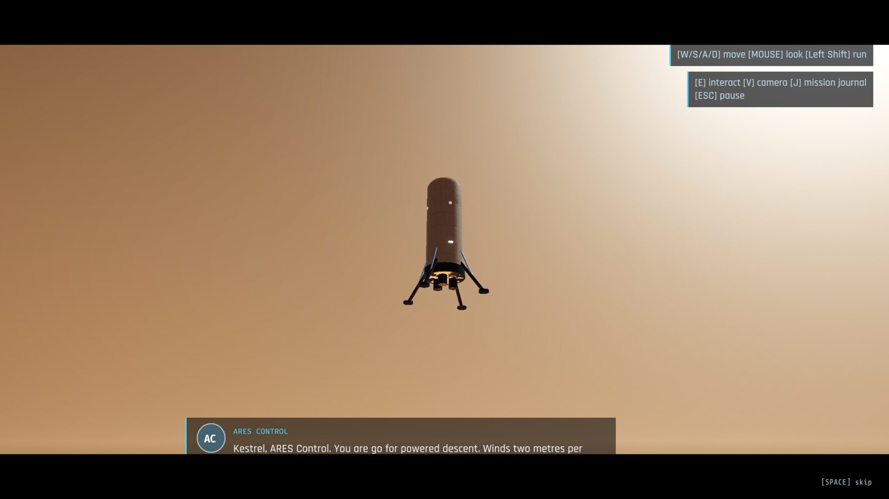 **Prologue.** The lander Kestrel descends to Jezero crater while ARES Control talks you down | 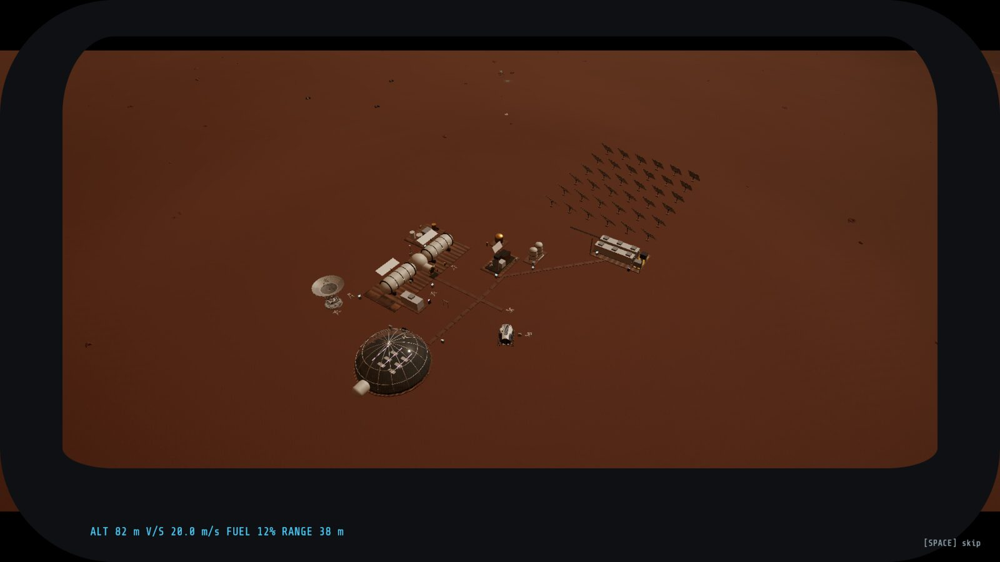 **Cockpit view** of the colony on final approach, with altitude, vertical speed, fuel and range |
|  **Conversations.** Colonists have names, roles and their own colour; subtitles follow the subtitle language | 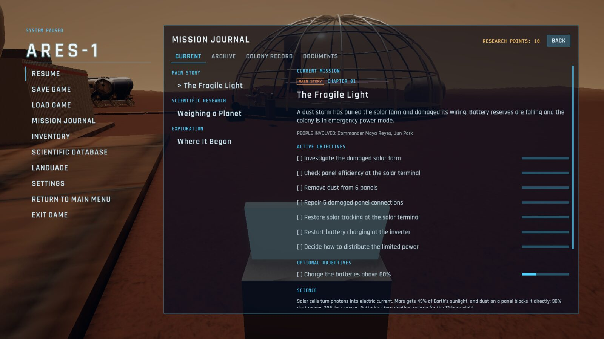 **Mission journal.** Current mission, active and optional objectives, rewards, the archive, decisions and documents |
| 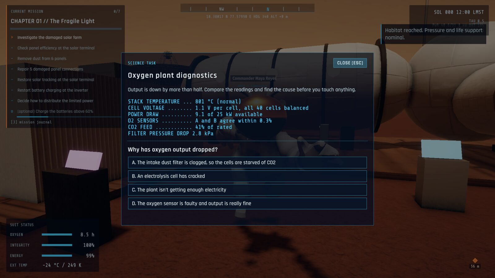 **Science tasks.** Read real instrument data and find the cause. Wrong answers get an explanation, not a penalty | 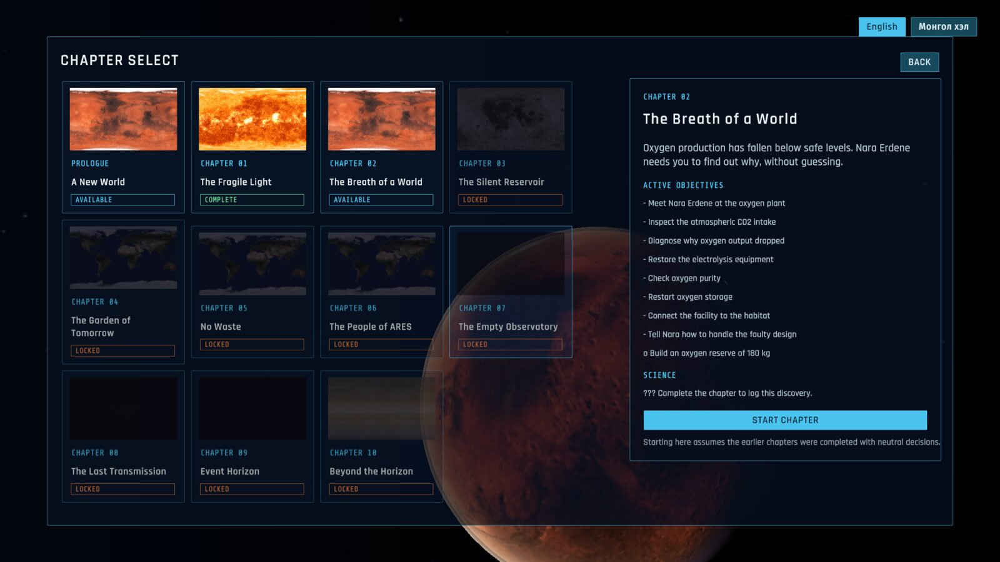 **Prologue and ten chapters,** each unlocked by finishing the one before |

### Black-hole laboratory

| | |
|---|---|
| 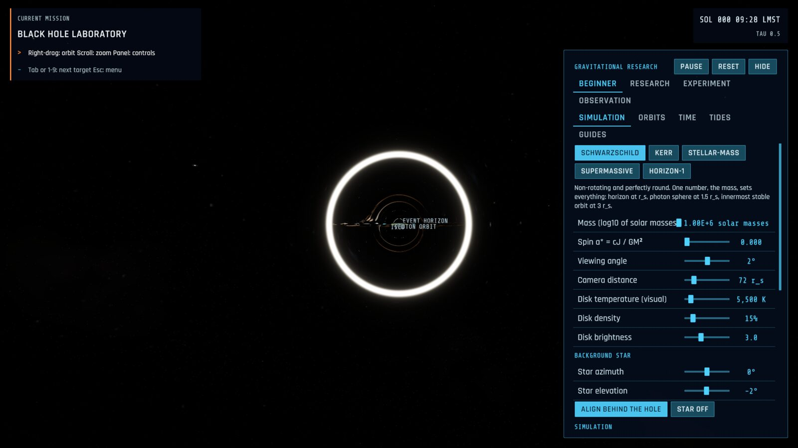 **Einstein ring.** Move a background star behind the hole and its light wraps into a ring | 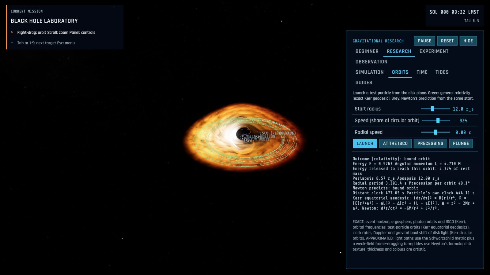 **Orbits.** Exact Kerr geodesics (green) against Newton's prediction (grey), with precession, energy and both clocks |
| 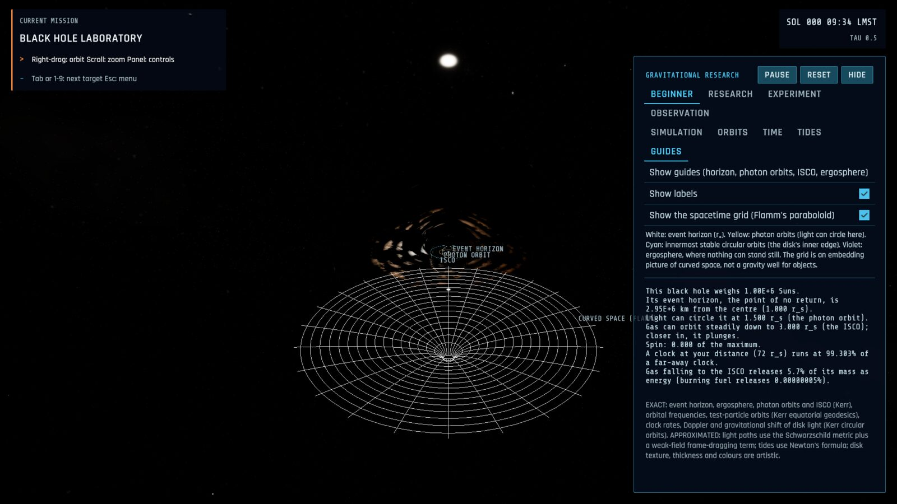 **Guides.** Horizon, photon orbits, ISCO, ergosphere and Flamm's paraboloid, with labels in Beginner mode |  **Supermassive preset.** Ray-traced lensing, Doppler beaming and gravitational redshift |

### In Mongolian

| | |
|---|---|
| 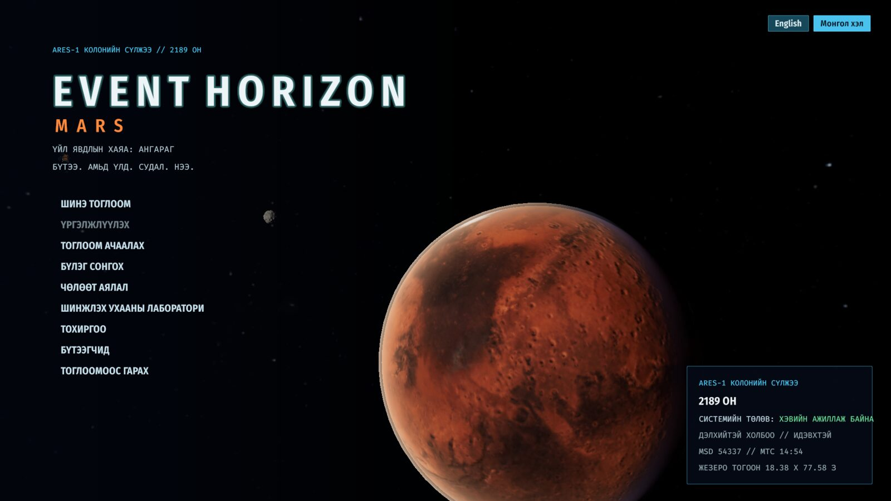 **Үндсэн цэс.** Every screen switches language instantly | 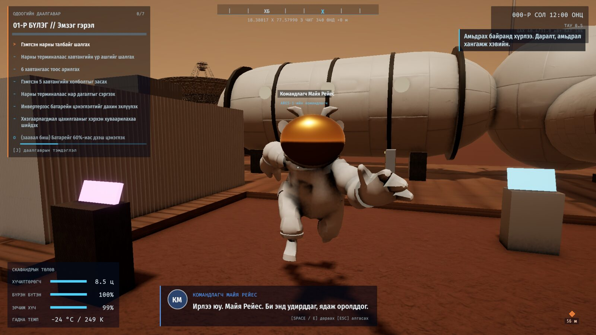 **Яриа.** Subtitles, HUD and objectives in Mongolian |
| 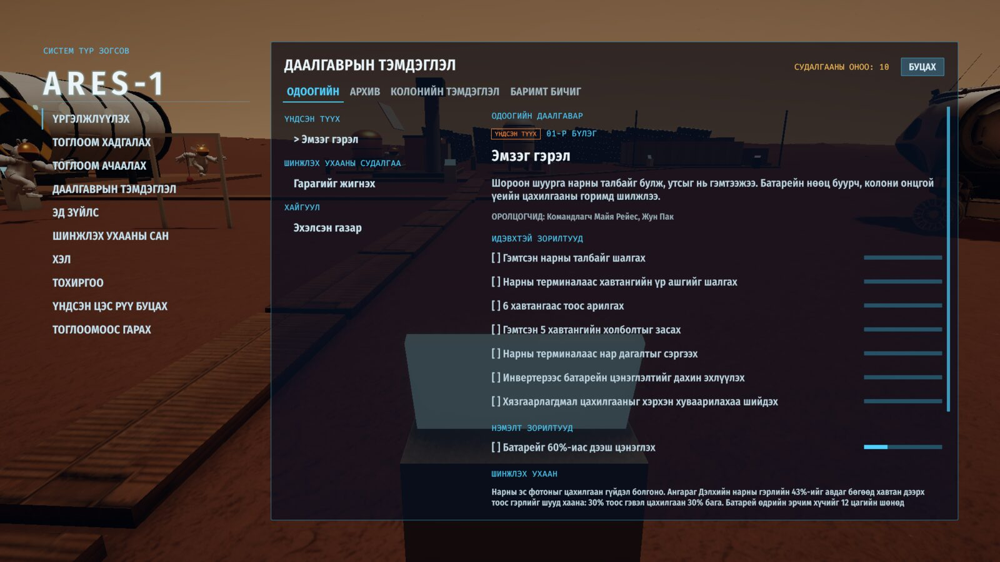 **Даалгаврын тэмдэглэл.** Mission journal | 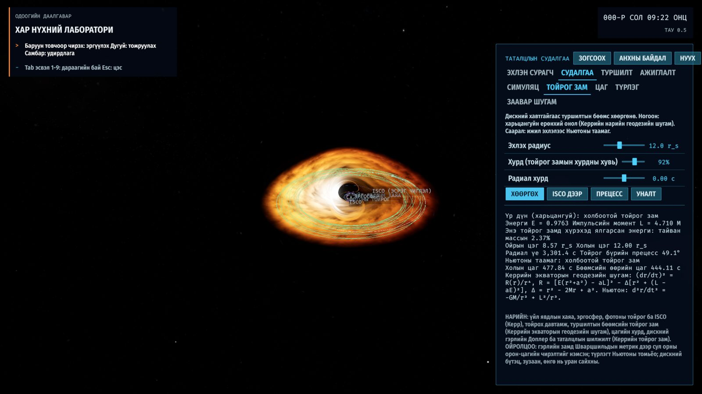 **Хар нүхний лаборатори.** The lab, its readouts and the formulas |

### The colony and space

| | |
|---|---|
|  **ARES-1 by day.** Habitat modules, the oxygen plant and the Deep Space Network antenna |  **Solar power station.** 36 sun-tracking tables and 400 kWh of batteries |
|  **Greenhouse.** An 18 m glass dome over hydroponic beds |  **Martian sunset.** Fine dust scatters blue light forward, so sunsets on Mars are blue |
|  **Night.** Floodlights switch on at dusk; the air drops to about −65 °C |  **Dust storm.** Visibility and solar output fall |
|  **Earth and the Moon** in the planetarium |  **Mars orbit.** Phobos in front of Mars, with relief from NASA's MOLA altimeter |
|  **Saturn** casting its shadow on the rings |  **Olympus Observatory,** the colony's telescope in orbit |

---

## The story

**Prologue: A New World.** A cinematic descent to Jezero crater, partly seen from the cockpit. You step out, run your
suit check and meet Commander Maya Reyes.

| Chapter | | What happens | Science |
|---|---|---|---|
| 1 | The Fragile Light | A dust storm buried the solar farm. Clean, repair and restore tracking, then decide who gets the limited power | Photovoltaics, batteries |
| 2 | The Breath of a World | Oxygen output has collapsed. Diagnose it from the instrument readings, fix it, check purity | Solid-oxide electrolysis |
| 3 | The Silent Reservoir | Find the first expedition's abandoned survey station, scan for ice and choose where to drill | Ground ice, distillation |
| 4 | The Garden of Tomorrow | Restore the greenhouse: pumps, nutrients, light, climate, crop choice, first harvest | Photosynthesis, hydroponics |
| 5 | No Waste | Repair the recycling plant and recover 95% of the water within a strict power budget | Closed loops |
| 6 | The People of ARES | Help the colonists, settle a dispute, and recommend the colony's strategy to the council | Governance |
| 7 | The Empty Observatory | Fly to orbit, bring Olympus Observatory back to life and analyse strange star-field distortions | Microlensing |
| 8 | The Last Transmission | Filter PROJECT HORIZON's 18-year-old signal, rebuild its timeline, decode its archive | Radio astronomy |
| 9 | Event Horizon | Rebuild the object in the black-hole lab and identify the signal's source | Kerr black holes, lensing |
| 10 | Beyond the Horizon | Prepare and launch a new expedition, recover Horizon's instruments and learn what happened | Orbits, the Penrose process |

**The cast:** Commander Maya Reyes (colony commander, survivor of the first expedition), Dr. Elias Chen
(astrophysicist), Engineer Nara Erdene (life support, from Arkhangai), Dr. Amara Okafor (botanist), Jun Park
(communications), plus Rafael Ortiz (mechanic) and Dr. Lena Sorensen (medical officer). Each has a personnel file,
a personal mission and conversations that change as the story moves on and react to your decisions.

**Decisions and endings.** Choices about power, the faulty filter, crops, communications, the council's strategy,
sharing Horizon's findings and the expedition ship move five reputation axes and your relationships. Four endings
(*A New Home*, *Beyond the Red Planet*, *The Horizon Project* and the secret *The Unknown*) depend on what you did
across the whole campaign, not on a final menu choice. The secret ending needs four classified archive fragments
hidden in optional objectives and a side mission.

The story stays grounded: the "impossible" object is a primordial black hole, an idea physicists have proposed for
the hypothetical Planet Nine.

---

## Missions

- **36 missions:** the main story, 5 colony requests, 6 exploration missions, 6 research missions, 6 deep-space
  observations and 2 emergencies with a time limit (failing one has consequences).
- **Activities:** travel and exploration, timed repairs, diagnosis from real readings, multiple-choice reasoning,
  numeric calculations (Kepler's third law, the Schwarzschild radius, vis-viva, Wien's law, pendulum gravity, radar
  ranging ...), slider puzzles (nutrient balance, antenna alignment, signal filtering, recycling optimisation),
  ordering steps, choosing within a power budget, flying to orbit and back, and the lab.
- **Rewards:** research points, technology, colony upgrades that change the simulation (anti-dust coating, a
  better electrolysis stack, a heavy ice drill, efficient LEDs, 97% water recycling), database entries and
  relationships.
- **Interface:** the HUD task panel shows the tracked mission and a waypoint; the journal (J) shows the current
  mission, description, active and optional objectives, rewards and people involved, plus the archive of completed
  missions with debriefs, the colony record (decisions, reputation, relationships, endings seen) and documents.
- Progress, decisions and unlocks are saved in every save file; changing language never touches them.

---

## The black-hole laboratory

An interactive simulation you can open from the Science Laboratory or reach in chapter 9. It doesn't depend on the
colony simulation.

- **Rendering (custom HLSL, per-pixel ray integration, no hardware ray tracing):** light paths follow the
  Schwarzschild null geodesic, giving the shadow, photon ring, lensed disk and Einstein rings; the horizon shrinks
  with spin, and a weak-field frame-dragging term makes the image asymmetric for a spinning hole. Disk light is
  shifted by the exact Kerr circular-orbit factor (Doppler boosting and dimming, gravitational redshift).
- **Presets:** Schwarzschild, Kerr, stellar-mass, supermassive and the story's HORIZON-1, each explained.
- **Controls:** mass, spin a* = cJ/GM², viewing angle, camera distance, disk temperature, density and brightness,
  background-star position (with *align behind the hole*), simulation speed, quality (Low / Medium / High) and the
  number of ray-integration steps. Pause and reset.
- **Readouts, all computed from the parameters:** r_s = 2GM/c², the Kerr horizon r₊, prograde and retrograde photon
  orbits and ISCOs (Bardeen, Press & Teukolsky), the ergosphere, angular momentum, ISCO orbital frequency, clock rate
  at your distance, shadow radius and accretion efficiency.
- **Orbits:** launch test particles; they follow exact Kerr equatorial geodesics next to a Newtonian orbit from the
  same start. You see the outcome (bound, circular, plunge, escape, capture), periapsis, apoapsis, period, precession
  per orbit, energy, and the particle's own clock against a distant clock.
- **Time:** two clocks, distant and local, for a hovering or an orbiting observer, with a note on why the answer
  depends on how you move.
- **Tides:** a probe that stretches and thins (never torn apart), with the stretch in m/s² and g and where it would
  reach 10 g.
- **Guides:** horizon, photon orbits, ISCOs, ergosphere and Flamm's paraboloid (an embedding picture of curved space).
- **Modes:** Beginner (plain language and labels), Research (formulas), Experiment (save settings A and B and
  compare them), Observation (free camera, no panel).
- The panel states what is exact and what is approximated: light paths ignore exact Kerr geodesics, tides use
  Newton's formula, and the disk's texture and colours are artistic.

The reference project [kavan010/black_hole](https://github.com/kavan010/black_hole) inspired the features. It has
no license, so none of its code was used; everything here was written from the physics.

---

## Languages

- **English and Mongolian** throughout: menus, settings, HUD, terminals, missions, objectives, dialogue,
  subtitles, tutorials, the science laboratory, the database, loading tips, notifications and the credits.
  About 2,000 strings per language, using a consistent glossary (Ангараг, колони, хүчилтөрөгч, хүлэмж, хар нүх,
  үйл явдлын хаяа, таталцлын линзлэлт ...).
- **Switch at any time:** on first start, from the main menu (EN | МН), in Settings > Language and in the pause
  menu. The interface rebuilds instantly, with no restart, and the choice is saved.
- **Separate interface, subtitle and voice languages.** No voice recordings ship yet: the system plays
  `Resources/Voice/<language>/<line key>` when a recording exists and otherwise shows the line as a subtitle, timed by
  length (with an adjustable reading speed).
- **Data-driven:** CSV tables in `Assets/EventHorizon/Resources/Localization/<Language>/` (UI, Missions, Dialogue,
  Science, Tutorials), one `key,text` row per string, and stable keys in code (`MENU_NEW_GAME`, `Q_C02_TITLE` ...).
  To add a language, add a folder and a row to `languages.csv`.
- **Fonts:** Rajdhani and Share Tech Mono have no Cyrillic, so Fira Sans Condensed and Fira Mono (SIL OFL) draw
  Mongolian, including Ө and Ү, and act as the global fallback for scientific symbols.

---

## The colony simulation

- **Sun and seasons** follow Jezero's latitude (18.4° N) and Mars' eccentric orbit (492-717 W/m² at the top of the atmosphere).
- **Solar power** responds to sun angle, atmospheric dust (optical depth τ) and dust settling on the panels
  (about 0.28% per sol, as Mars Pathfinder measured). Panels track the Sun, can be cleaned, and can be damaged.
- **Oxygen** from a MOXIE-style solid-oxide plant (2 CO2 → 2 CO + O2) or water electrolysis.
- **Water** from buried ice, recycled at 93-97%. **Food** from hydroponic beds with crop-specific growth.
- **Crew** consumption follows NASA's Baseline Values and Assumptions Document.
- **Weather:** sols, seasons, a MEDA-like temperature swing and dust storms. **Suit:** about 8 hours of oxygen.
- **Buildings** are assembled from detailed parts with Poly Haven PBR materials; Forward+ lighting, SSAO and sky reflections.
- **Space:** a procedural star field, planets with a custom atmosphere shader, MOLA and LOLA relief, an instanced
  asteroid belt, a comet, and a Mars-orbit scene with Phobos, Deimos, the MRO and Olympus Observatory.
- **Modes:** the campaign, Free Exploration (a sandbox with its own save) and the Science Laboratory (28 topics, most with calculators).

---

## Project status

| Working | Not yet |
|---|---|
| Prologue and all ten chapters, 36 missions, four endings | Recorded voice acting (the system is ready; dialogue is subtitled) |
| English and Mongolian, switchable at any time | Building interiors (entering the habitat plays a conversation) |
| Mission journal, decisions, reputation, relationships, documents | Realistic astronaut and colonist models (they use a cartoon placeholder) |
| Black-hole lab: presets, orbits, clocks, tides, guides, modes | Exact Kerr light paths (the renderer approximates frame dragging) |
| Cinematic landing, launches to orbit, endings with epilogues | Windows build (needs Unity's Windows Build Support module) |
| Colony simulation, sandbox, planetarium, Mars orbit, Linux build | Interplanetary flight is a title card, not a flyable ship |

---

## Getting started

### Requirements
- **Unity 6** with the Universal Render Pipeline (tested with **6000.6.8f1**). Install it through Unity Hub.
- **Python 3**, to download the free assets (standard library only).
- About 3 GB of free disk space.

### 1. Clone the repository and download the assets

```bash
git clone https://github.com/TariatiinEserguu/EventHorizon-Mars.git
cd EventHorizon-Mars
python3 tools/fetch_assets.py
```

The raw asset packs (Kenney, Poly Haven, Solar System Scope, NASA) are not stored in the repository. The script
downloads them and checks each file against a recorded SHA-256 hash. Run it **before** opening Unity, so the
committed `.meta` files find their assets. Optional: `pip install gdown` lets it try the Quaternius packs; if it
reports `MANUAL`, download the folder in a browser and run `python3 tools/fetch_assets.py --only <id>`.

### 2a. Build and run from the command line

```bash
~/Unity/Hub/Editor/6000.6.8f1/Editor/Unity -batchmode -nographics -projectPath . \
    -executeMethod EventHorizon.EditorTools.BuildScript.SetupAndBuildLinux -quit
./Builds/Linux/EventHorizonMars.x86_64
```

This one command:
1. builds the prefabs and all five scenes, including the story's locations and colonists;
2. checks every third-party asset and every localization table;
3. builds the Linux player.

### 2b. Or open the project in the Unity editor

1. In Unity Hub, choose *Add > Add project from disk*.
2. Run the **Event Horizon > Assets** menu items 0 to 4, in order.
3. Open `Assets/EventHorizon/Scenes/MainMenu.unity` and press Play.

---

## Controls

| Action | Key |
|---|---|
| Move / look | W A S D / mouse |
| Run / crouch / jump | Shift / Ctrl / Space |
| Interact: talk, repair, scan, use terminals, harvest, mine ice | E |
| Mission journal | J |
| First / third person | V |
| Next line / skip a conversation or cinematic | Space or E / Esc |
| Pause menu | Esc |
| Space scenes: orbit, zoom, next target | Right-drag or arrows, scroll, Tab or 1-9 |

You can rebind every key in **Settings > Controls**. Gamepads are supported.

---

## Testing

- **Story test:** `./Builds/Linux/EventHorizonMars.x86_64 -batchmode -nographics -eh-storytest report.txt` plays the
  whole campaign four times with different decision profiles, one aimed at each ending. Along the way it saves and
  reloads, switches language, and checks prerequisites. It then confirms that every key the content uses exists in
  every language with matching placeholders. Current result: all 11 main missions complete in every run, all four
  endings are reached, and 0 keys are missing in either language.
- **Localization validator** (runs in every build): checks that the languages match key for key, that every key
  used in code exists, and that every character has a glyph in the font that draws it.
- **Visual test:** `./Builds/Linux/EventHorizonMars.x86_64 -eh-screenshots ./shots [-eh-lang mn]` tours the menus,
  the colony, a conversation, the journal, a science task, the planetarium, Mars orbit and the lab. It saves
  screenshots and `performance.txt`. All the screenshots in this README come from it.

---

## Performance

Measured with the visual test at 1920x1080, **High** preset, on an RTX 4050 Laptop GPU (OpenGL), Ryzen 7 7735H and
16 GB RAM.

| Scene | 120 FPS cap: average (1% low) | Uncapped: average (1% low) | Memory |
|---|---|---|---|
| Main menu | 118 (118) | 629 (442) | ~460 MB |
| Colony, day | 117 (120) | 248 (137) | ~470 MB |
| Planetarium | 118 (119) | 247 (148) | ~460 MB |
| Mars orbit | 119 (119) | 409 (142) | ~470 MB |
| Black-hole lab | 118 (119) | 251 (124) | ~455 MB |

The uncapped numbers are from the build before the story update. The Linux build is about 330 MB.

---

## Project structure

```
Assets/EventHorizon/
  Scripts/Runtime/
    Story/        Quests, dialogue, experiments, cinematics, endings, the story test
    Core/         Localization (Loc), settings, input
    Space/        Black hole, lab, orbit camera, planets, asteroids
    UI/           Menus, HUD, journal, terminals, black-hole lab console
    Colony/ Agriculture/ Astronaut/ Game/ Procedural/ Interaction/
  Scripts/Editor/ Scene builders (colony, story world, space), validators, build script
  Shaders/        Mars sky, deep-space sky, star field, planets, rings, Sun, black-hole lensing
  Resources/Localization/  English/ and Mongolian/ CSV tables, languages.csv
  Fonts/          Rajdhani, Share Tech Mono, Fira Sans Condensed, Fira Mono (SIL OFL)
  Scenes/         MainMenu, MarsColony, SpaceLab (planetarium), MarsOrbit, BlackHoleLab
tools/            asset_manifest.json, fetch_assets.py
docs/screenshots/ Images used in this README
```

---

## Science sources

- NASA Mars Fact Sheet and Planetary Fact Sheets; NASA Baseline Values and Assumptions Document (NASA/TP-2015-218570)
- Hecht et al. (2021), *Mars Oxygen ISRU Experiment (MOXIE)*; Appelbaum & Flood (1990); Landis (1996)
- Rodriguez-Manfredi et al. (2023), MEDA at Jezero; Smith et al. (2001, 2010), MOLA and LOLA topography
- Schwarzschild (1916); Kerr (1963); Bardeen, Press & Teukolsky (1972); Penrose (1969); Misner, Thorne & Wheeler, *Gravitation*
- Paczynski (1986), gravitational microlensing; Scholtz & Unwin (2020), Planet Nine as a primordial black hole

---

## Assets and licenses

All third-party assets are free, and each license has been checked: Kenney and Poly Haven (CC0), Solar System
Scope textures (CC BY 4.0), NASA models, imagery and elevation data (NASA media guidelines), Quaternius (CC0) and
the fonts (SIL Open Font License). The full list is in **[ASSET_CREDITS.md](ASSET_CREDITS.md)**, generated from
[`tools/asset_manifest.json`](tools/asset_manifest.json), and appears in the in-game credits.

This is a hackathon project. It is not affiliated with or endorsed by NASA. NASA models and imagery are used under
NASA's media usage guidelines, and the NASA insignia is not used.

Contributions are welcome. To add an asset, read its license, add it to `tools/asset_manifest.json` and run
`python3 tools/fetch_assets.py`. To add a language, see [Languages](#languages).

---

## Монгол хэлээр

**ҮЙЛ ЯВДЛЫН ХАЯА: АНГАРАГ** бол 2026 оны НАСА-гийн Хакатонд зориулан Тариатын Эсэргүүгийн Unity 6 дээр бүтээсэн,
шинжлэх ухаанд суурилсан Ангарагийн колонийн тоглоом. Тоглоом бүхэлдээ англи болон монгол хэл дээр тоглогдоно.

2189 он. Та Ангараг дээрх хүн төрөлхтний хамгийн том суурин ARES-1-д ирсэн сансар судлалын системийн инженер.
Колонийн цахилгаан, хүчилтөрөгч, ус, хүнсийг хангаж, арван найман жилийн өмнө сураггүй алга болсон PROJECT HORIZON
экспедицийн нууцыг шинжлэх ухааны аргаар тайлна.

- **Түүх:** оршил ба арван бүлэг, 36 даалгавар, долоон дүр, таны шийдвэрээс хамаарах дөрвөн төгсгөл.
- **Хар нүхний лаборатори:** Шварцшильд, Керр, одны масстай, асар том масстай хар нүх; таталцлын линзлэлт,
  Эйнштейний цагираг, Керрийн тойрог зам, цагийн удаашрал, түрлэгийн хүч, бүх утга томьёогоор тооцоологдоно.
- **Хэл:** хэлийг эхлэх үед, үндсэн цэс, Тохиргоо, түр зогсоох цэснээс хүссэн үедээ сольж болно. Явц тань хадгалагдана.
- **Тоглоом бүтээх:** дээрх [Getting started](#getting-started) хэсгийн командуудыг ашиглана уу.
