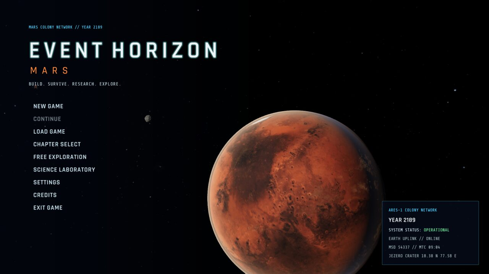
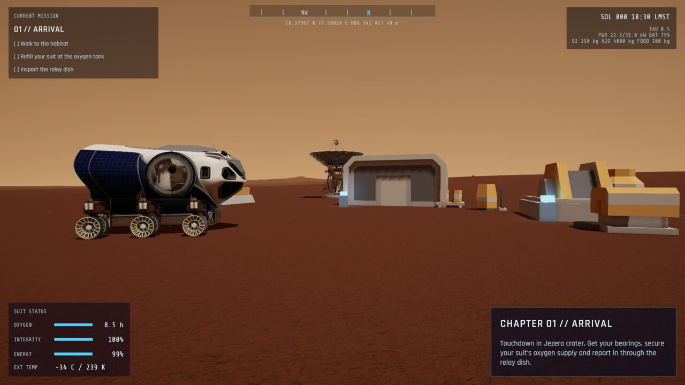
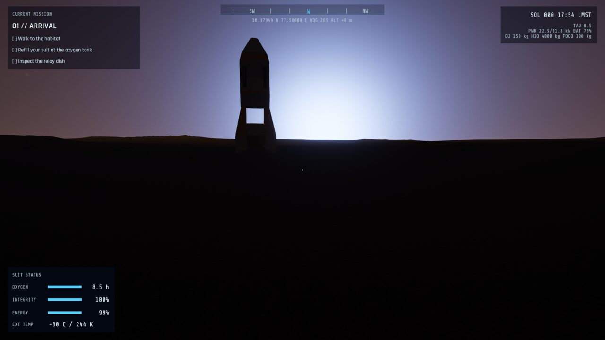
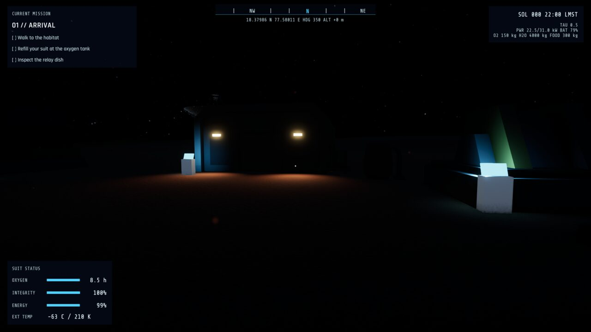
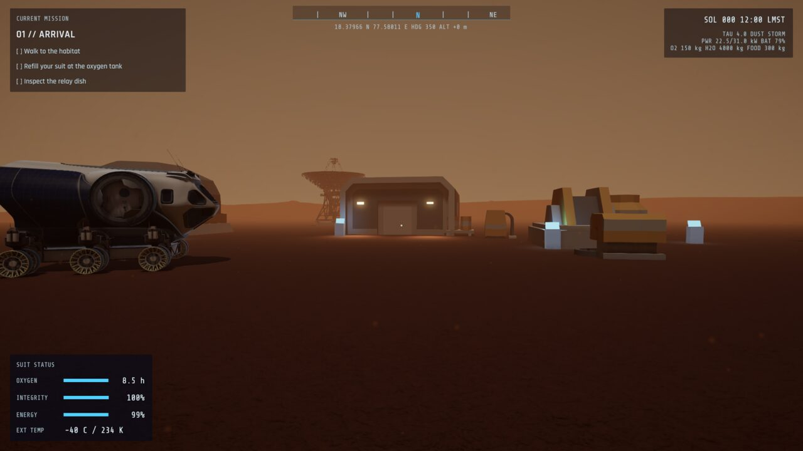
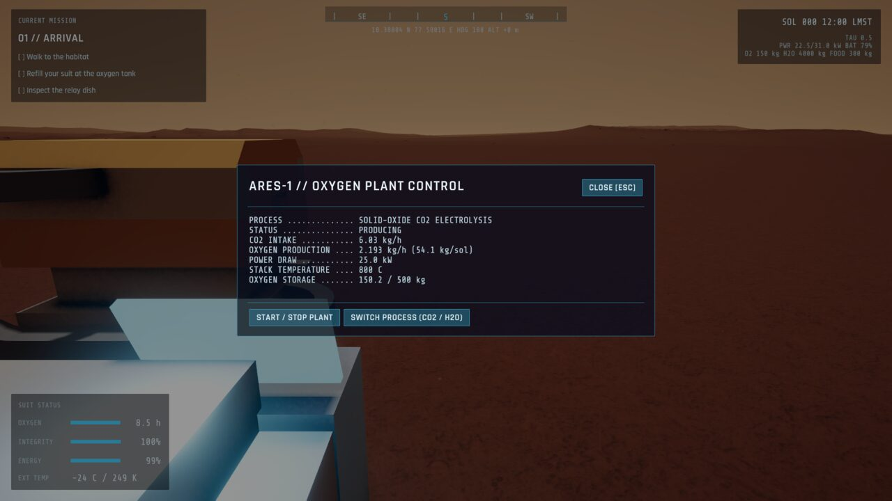
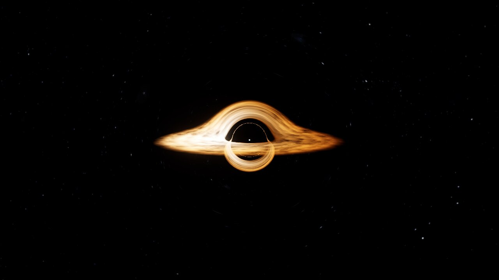
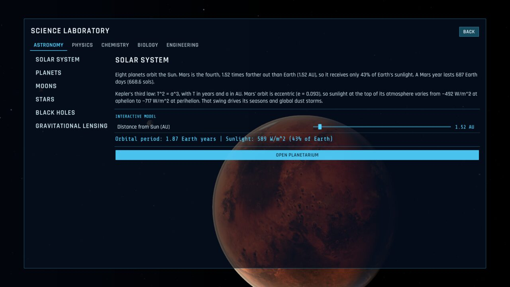
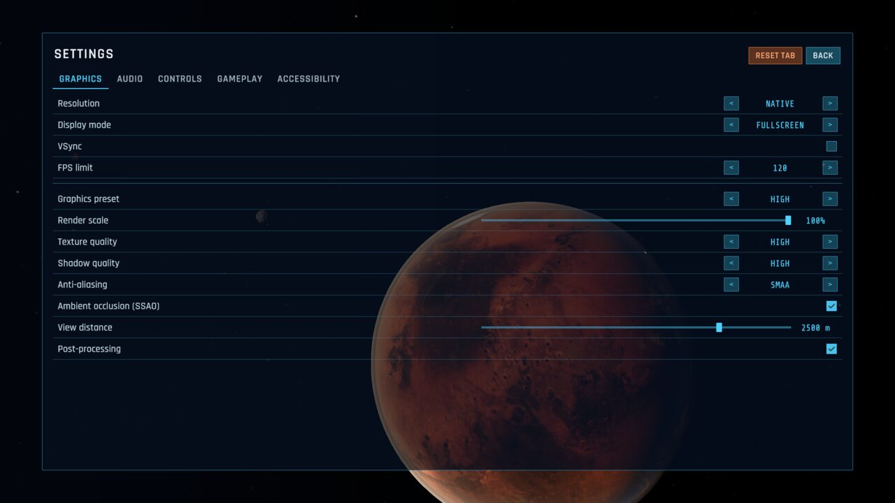

# EVENT HORIZON: MARS

**Build. Survive. Research. Explore.**

A science-driven Mars colony survival game by **Tariatiin Eserguu**, built in Unity 6 for the **2026 NASA Hackathon**.
It is the year 2189, and you are an astronaut at ARES-1, humanity's first permanent settlement, in Jezero crater.
You keep the colony breathing, powered and fed. Every system runs on real physics and published mission data.



---

## Screenshots

| | |
|---|---|
|  **Colony by day.** Butterscotch sky, NASA SEV rover and DSN antenna |  **Martian sunset.** Dust scatters blue light forward, so sunsets on Mars are blue |
|  **Night.** Habitat floodlights switch on at dusk; air drops to about -65 C |  **Dust storm.** Optical depth rises, visibility and solar output fall |
|  **Facility terminal.** Live data from the oxygen plant simulation |  **Black-hole lab.** Per-pixel light bending, Einstein ring, Doppler beaming |
|  **Science laboratory.** 25 topics with interactive models |  **Settings.** Graphics presets, FPS caps, render scale, key rebinding |

---

## Features

### Colony simulation, with real numbers
- **Sun and seasons.** The sun's position follows Jezero's latitude (18.4 N), time of day and Mars' season.
  Sunlight varies from ~492 to ~717 W/m^2 over Mars' eccentric orbit.
- **Solar power.** Panels respond to sun angle, atmospheric dust (optical depth tau) and settling dust
  (about 0.28% per sol, as Mars Pathfinder measured). They track the sun and can be cleaned. Batteries carry the night.
- **Oxygen.** A MOXIE-style solid-oxide CO2 electrolysis plant (2 CO2 -> 2 CO + O2), or water electrolysis.
  Power and efficiency figures come from the MOXIE experiment and scaled-up plant estimates.
- **Water.** Mine buried ice and recycle 93-95% of it.
- **Food.** Hydroponic beds with crop-specific growth times, yields, transpiration and grow-light power.
- **Crew.** Oxygen, water and food use per person follow NASA's Baseline Values and Assumptions Document.
- **Weather.** Sols, seasons, a day/night temperature swing like Perseverance's MEDA measurements, and occasional dust storms.
- **Suit.** About 8 hours of oxygen, a battery that drains faster in the cold, and suit integrity that wears down in storms.

### Game modes
- **Campaign.** 10 chapters. Chapters 1-5 are playable, with objectives tied to real actions (cleaning panels,
  running the oxygen plant, mining ice, harvesting). Finishing a chapter unlocks the next.
- **Free exploration.** A sandbox with options for simulation speed, starting resources, infinite oxygen, dust storms
  and crew size. It has its own save slot.
- **Science laboratory.** Astronomy, physics, chemistry, biology and engineering topics. Each explains the science
  and most include an interactive calculator; some open a live simulation.

### Interface
- Animated main menu over a real-time view of Mars, Phobos, Deimos and the ARES-1 beacon.
- **New game:** astronaut name and callsign, suit color, four difficulty levels and three tutorial levels.
- **Save/load:** 8 save slots with thumbnails, plus rename and delete.
- **Settings:** graphics, audio, controls (keys can be rebound), gameplay and accessibility, all saved between sessions.
- **In game:** HUD (oxygen, suit integrity, energy, temperature, mission, Martian time, compass, coordinates),
  facility terminals and a pause menu.
- **Screens:** loading screen with science facts, and scrolling credits.

### Visuals
- Universal Render Pipeline with ambient occlusion, soft shadows and filmic tone mapping.
- **Graphics options:** Low, Medium and High presets, 30/60/90/120/unlimited FPS caps, and render scale.
- Custom Mars sky shader: butterscotch by day, blue around the setting sun, stars at night.
- Custom black-hole shader that traces light rays near a non-spinning black hole: the shadow, photon ring,
  Einstein ring, lensed accretion disk, Doppler beaming and gravitational redshift.
  The shader's header lists which parts are physics and which are artistic approximations.
- NASA 3D models: Perseverance, Ingenuity, the Space Exploration Vehicle, a Deep Space Network antenna and the
  Mars Reconnaissance Orbiter.

---

## Project status

| Working | Not yet |
|---|---|
| Colony simulation, campaign chapters 1-5, sandbox, science lab | Chapters 6-10 (shown as "in development") |
| Main menu, saves, settings, pause menu, HUD, terminals | Map screen; Tab/J/M shortcuts (inventory and objectives are in the pause menu) |
| Day/night, seasons, dust storms, temperature | Building interiors |
| NASA rover, antenna and orbiter models | Realistic astronaut (the current one is a cartoon placeholder) |
| Black-hole lab and planetarium | Realistic habitat, oxygen plant and greenhouse models (current ones are low-poly) |
| Linux build | Windows build (needs Unity's Windows Build Support module) |

---

## Getting started

### Requirements
- **Unity 6** with the Universal Render Pipeline (tested with **6000.6.8f1**). Install it through Unity Hub.
- **Python 3**, to download the free assets (standard library only).
- About 2 GB of free disk space for Unity's import cache.

### 1. Clone and download the assets

```bash
git clone https://github.com/TariatiinEserguu/EventHorizon-Mars.git
cd EventHorizon-Mars
python3 tools/fetch_assets.py
```

The raw asset packs (Kenney, Poly Haven, Solar System Scope, NASA) are not stored in the repository. The script
downloads them and checks each file against a recorded SHA-256. Run it **before** opening Unity, so the committed
`.meta` files find their assets.

Optional: `pip install gdown` lets the script try the Quaternius packs on Google Drive. Drive often throttles these;
if the script reports `MANUAL`, download the folder in a browser, unzip it where the script says, and run
`python3 tools/fetch_assets.py --only <id>`.

### 2a. Build and run from the command line

```bash
~/Unity/Hub/Editor/6000.6.8f1/Editor/Unity -batchmode -nographics -projectPath . \
    -executeMethod EventHorizon.EditorTools.BuildScript.SetupAndBuildLinux -quit
./Builds/Linux/EventHorizonMars.x86_64
```

This builds the prefabs and the `MainMenu`, `MarsColony` and `SpaceLab` scenes, validates every third-party asset
(license record, shaders, polygon budget, scale), and builds the Linux player.

### 2b. Or open it in the Unity editor

Add the folder in Unity Hub (*Add > Add project from disk*). On first load the project switches to linear color
and creates the URP pipeline asset. Run the **Event Horizon > Assets** menu items 0 to 4 in order,
then open `Assets/EventHorizon/Scenes/MainMenu.unity` and press Play.

---

## Controls

| Action | Key |
|---|---|
| Move / look | W A S D / mouse |
| Run / crouch / jump | Shift / Ctrl / Space |
| Interact (clean panels, refill suit, use terminals, harvest, mine ice) | E |
| First / third person | V |
| Pause menu | Esc |

All keys can be rebound in **Settings > Controls**. Gamepads are supported too.

---

## Performance

Measured with the built-in visual test at 1920x1080, **High** preset, 120 FPS cap, on an RTX 4050 Laptop GPU
(OpenGL) with a Ryzen 7 7735H and 16 GB RAM:

| Scene | Average FPS | Memory |
|---|---|---|
| Main menu | 118 | ~390 MB |
| Colony (day) | 117 | ~380 MB |
| Black-hole lab | 118 | ~340 MB |

The Linux build is 229 MB. To reproduce the test:

```bash
./Builds/Linux/EventHorizonMars.x86_64 -eh-screenshots ./shots
```

It tours the menus, the colony (day, sunset, night, dust storm, terminal, pause menu) and the black-hole lab. It saves
a screenshot of each view plus `performance.txt`, then quits. The screenshots above came from this test.

---

## Project structure

```
Assets/
  EventHorizon/
    Scripts/Runtime/    Colony, Agriculture, Astronaut, Space, Procedural, Game (saves, campaign), UI, Core
    Scripts/Editor/     Import rules, asset validator, prefab and scene builders, build script
    Shaders/            BlackHoleLensing, MarsSky, AtmosphereRim
    Resources/UI/       Stylesheet and UI resources
    Fonts/              Rajdhani, Share Tech Mono (SIL Open Font License)
    Generated/          Prefabs, materials, meshes, terrain built by the editor tools
    Scenes/             MainMenu, MarsColony, SpaceLab
  ThirdParty/           Downloaded asset packs (git-ignored; SOURCE.json license records are committed)
tools/
  asset_manifest.json   Every third-party asset: source, license, attribution
  fetch_assets.py       Downloads the assets and regenerates ASSET_CREDITS.md
docs/screenshots/       Images used in this README
```

---

## Science sources

- NASA Mars Fact Sheet and Planetary Fact Sheets
- NASA Baseline Values and Assumptions Document (NASA/TP-2015-218570): crew consumption rates
- Hecht et al. (2021), *Mars Oxygen ISRU Experiment (MOXIE)*, Space Science Reviews
- Appelbaum & Flood (1990), *Solar radiation on Mars*: diffuse sunlight under dust
- Landis (1996), dust accumulation on Mars Pathfinder's solar arrays
- Rodriguez-Manfredi et al. (2023), MEDA weather measurements at Jezero crater
- Schwarzschild (1916), and Misner, Thorne & Wheeler, *Gravitation*: the black-hole shader

---

## Assets and licenses

All third-party assets are free and license-checked: Kenney and Poly Haven (CC0), Solar System Scope (CC BY 4.0),
NASA (NASA media guidelines), Quaternius (CC0 per the pack page) and the fonts (SIL Open Font License).
The source, license and attribution for every asset are in **[ASSET_CREDITS.md](ASSET_CREDITS.md)**, generated from
[`tools/asset_manifest.json`](tools/asset_manifest.json). The same text appears in the in-game credits.

This is a hackathon project. It is not affiliated with or endorsed by NASA. NASA models and imagery are used under
NASA's media usage guidelines, and the NASA insignia is not used.

---

## Contributing

Contributions are welcome. Open an issue or submit a pull request with improvements.

To add an asset, read its license first, add an entry to `tools/asset_manifest.json`, then run
`python3 tools/fetch_assets.py`. Assets without a recorded license fail the validator
(**Event Horizon > Assets > Validate Third-Party Assets**).
