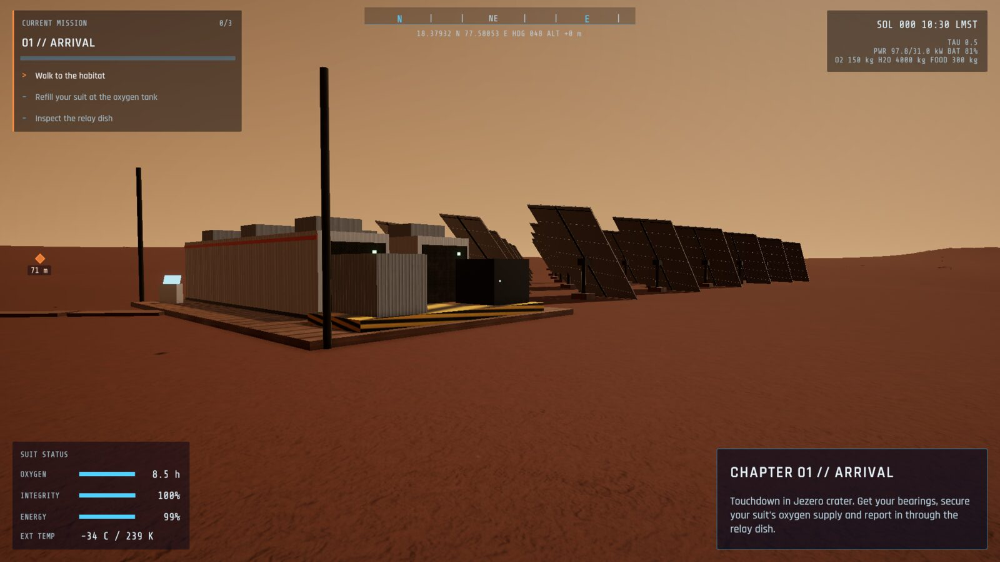
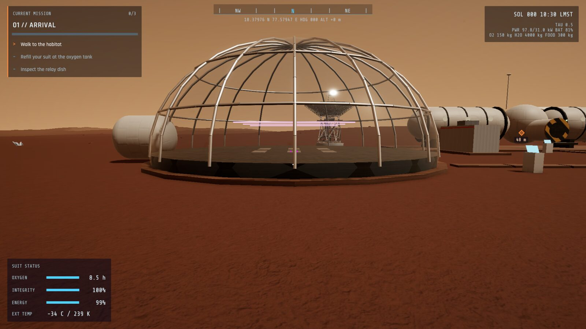
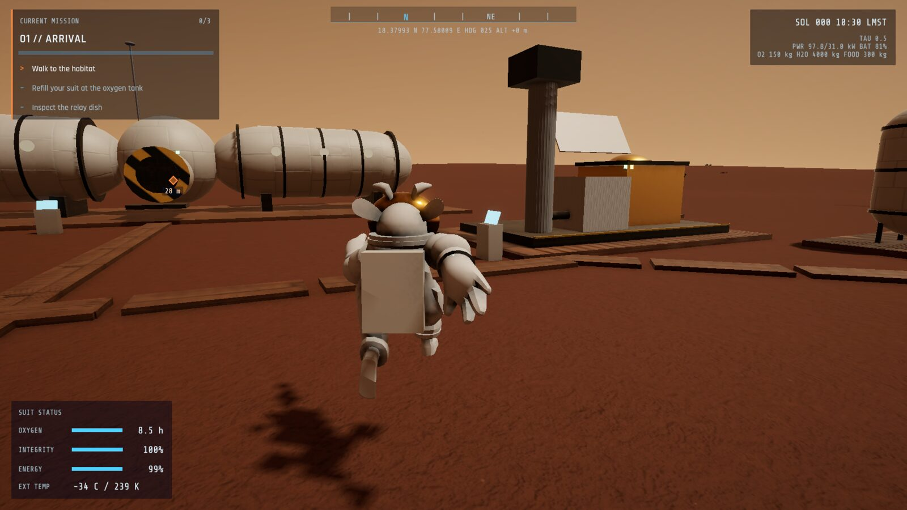
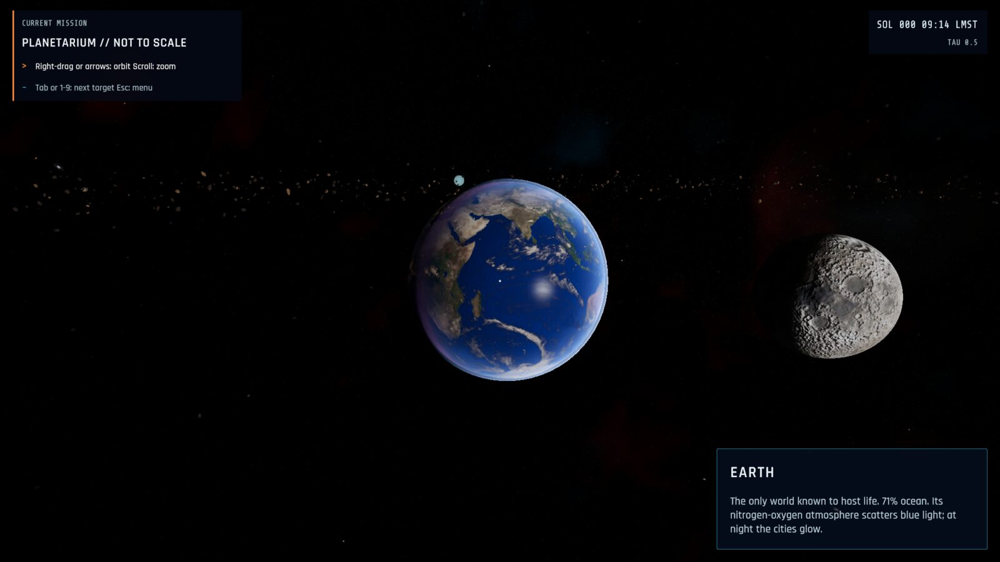
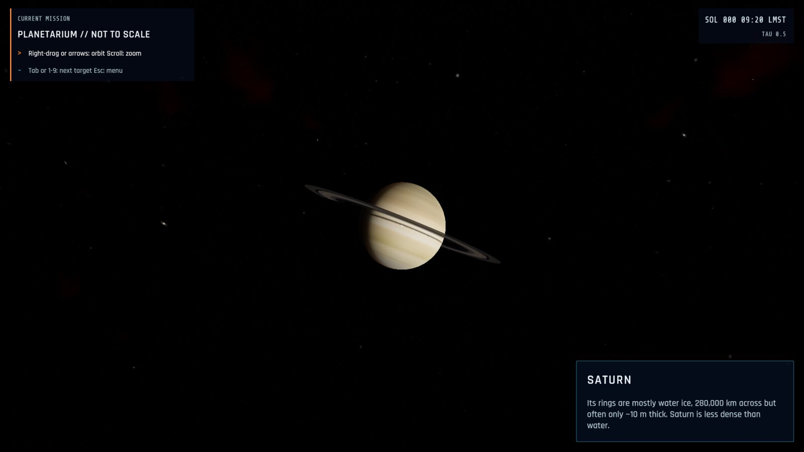
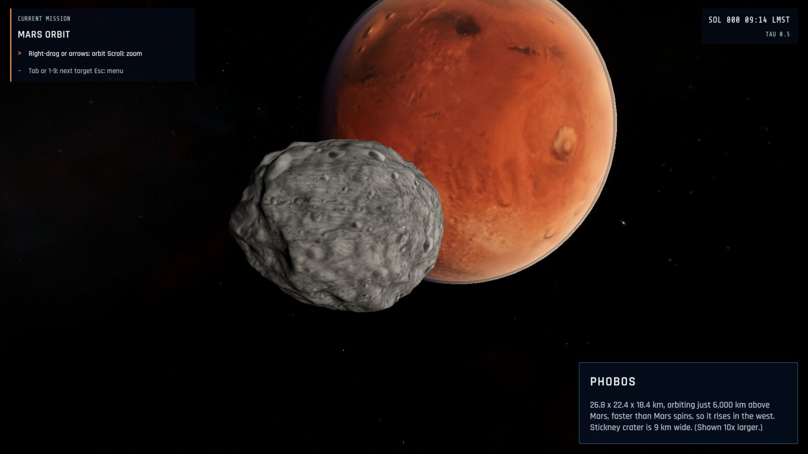
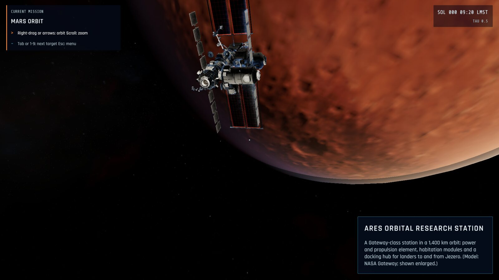
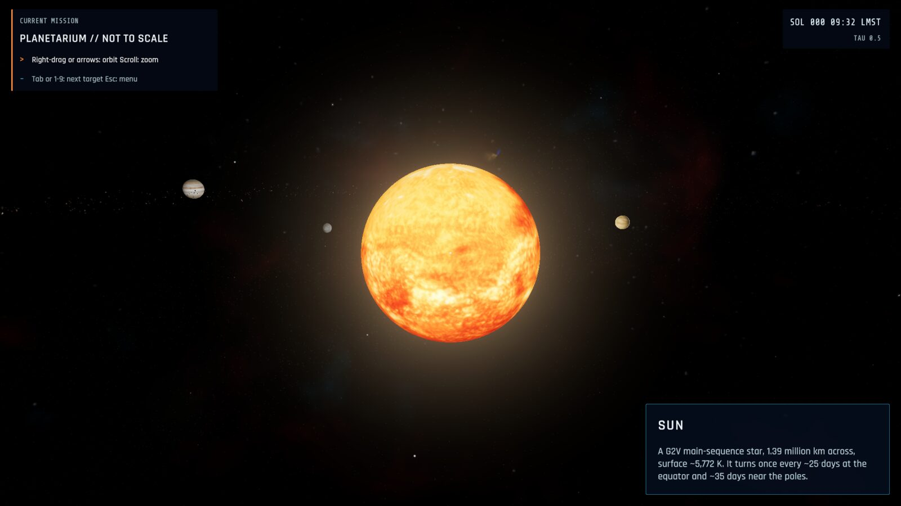
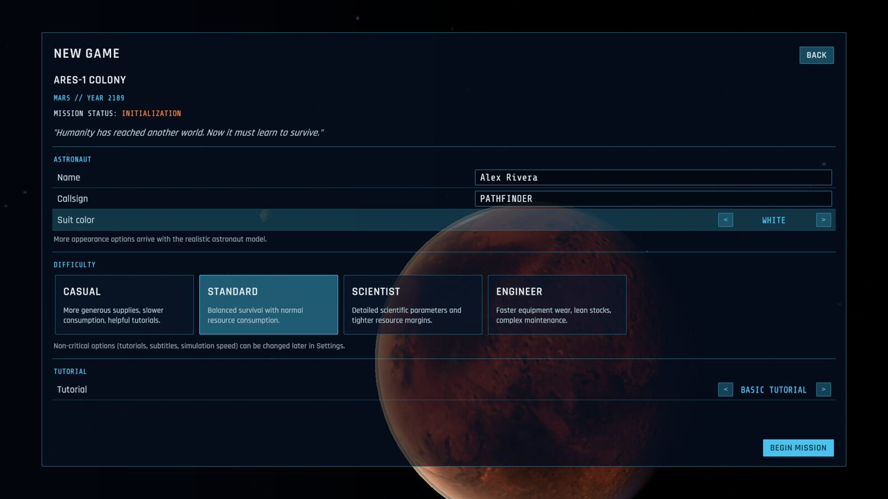

# EVENT HORIZON: MARS

**Build. Survive. Research. Explore.**

A science-driven Mars colony survival game by **Tariatiin Eserguu**, made in Unity 6 for the **2026 NASA Hackathon**.

It is the year 2189. You are an astronaut at ARES-1, humanity's first permanent settlement, in Jezero crater.
Your job is to keep the colony breathing, powered and fed. Every system runs on real physics and published
mission data. Away from the colony you can tour the Solar System, orbit Mars with Phobos and Deimos, and
experiment with a black hole.


---

## Contents

- [Screenshots](#screenshots)
- [Features](#features)
- [Project status](#project-status)
- [Getting started](#getting-started)
- [Controls](#controls)
- [Performance](#performance)
- [Project structure](#project-structure)
- [Science sources](#science-sources)
- [Assets and licenses](#assets-and-licenses)

---

## Screenshots

### The colony

| | |
|---|---|
|  **ARES-1 by day.** Habitat modules, the oxygen plant and the Deep Space Network antenna. The task panel and waypoint marker lead you to the next objective |  **Solar power station.** 36 sun-tracking tables (about 1,040 m^2) feed 400 kWh of battery containers |
|  **Greenhouse.** An 18 m glass dome over hydroponic beds and LED grow lights |  **Third person.** Press V to switch views |
|  **Martian sunset.** Fine dust scatters blue light forward, so sunsets on Mars are blue |  **Night.** Floodlights switch on at dusk; the air drops to about -65 C |
|  **Dust storm.** Optical depth rises, so visibility and solar output fall |  **Facility terminal.** Live readings from the power simulation, with actions |

### Space

| | |
|---|---|
|  **Earth and the Moon.** Oceans reflect the Sun, city lights glow on the night side |  **Saturn.** The planet casts its shadow across the rings |
|  **Mars orbit.** Phobos in front of Mars. Mars' relief comes from NASA's MOLA laser altimeter |  **ARES orbital station.** Based on NASA's Gateway model |
|  **The Sun.** An animated surface with granulation and a glowing corona |  **Black-hole lab.** Per-pixel light bending, the Einstein ring and Doppler beaming, with live physics readouts |

### Menus

| | | |
|---|---|---|
|  **New game** |  **Settings** |  **Science laboratory** |

---

## Features

### A colony that runs on real numbers
- **Sun and seasons.** The Sun's position follows Jezero's latitude (18.4 N), the time of day and the Martian
  season. Sunlight at the top of the atmosphere varies from about 492 to 717 W/m^2 over Mars' eccentric orbit.
- **Solar power.** Output depends on the Sun's angle, dust in the air (optical depth, tau) and dust settling on the
  panels (about 0.28% per sol, as Mars Pathfinder measured). Panels track the Sun and can be cleaned.
  Batteries carry the colony through the night.
- **Oxygen.** A MOXIE-style plant splits carbon dioxide (2 CO2 -> 2 CO + O2). Water electrolysis is a backup.
  Power and efficiency figures come from the MOXIE experiment and estimates for a full-size plant.
- **Water.** Mine buried ice and recycle 93-95% of the water you use.
- **Food.** Hydroponic beds, each crop with its own growth time, yield, water use and grow-light power.
- **Crew.** Oxygen, water and food use per person follow NASA's Baseline Values and Assumptions Document.
- **Weather.** Sols and seasons, a day/night temperature swing like Perseverance's MEDA measurements, and dust storms.
- **Suit.** About 8 hours of oxygen, a battery that drains faster in the cold, and suit integrity that wears down in storms.

### Game modes
- **Campaign.** 10 chapters. Chapters 1-5 are playable. Objectives are tied to real actions: cleaning panels,
  running the oxygen plant, mining ice and harvesting crops. Finishing a chapter unlocks the next.
- **Free exploration.** A sandbox with its own save slot. You choose the simulation speed, starting resources,
  crew size, dust storms and infinite oxygen.
- **Science laboratory.** Topics in astronomy, physics, chemistry, biology and engineering. Each one explains the
  science, most have an interactive calculator, and some open a live simulation (planetarium, Mars orbit, black hole).

### The colony buildings
Every building is assembled from detailed parts and uses Poly Haven PBR materials:
- Habitat modules shaped like pressure vessels, with an airlock, windows, radiators and floodlights.
- A solar power station: tracking tables, battery containers, an inverter, a transformer and cable trays.
- A MOXIE-style oxygen plant with an intake tower, compressor and gold-foil insulated reactor housing.
- Water and oxygen tanks, a food store, a lander and a glass greenhouse dome.

### Space
- A procedural star field with background galaxies and nebulae.
- Planets with a custom shader: atmospheric glow, city lights and sunlight reflecting off Earth's oceans, and ring shadows on Saturn.
- Real relief from NASA altimetry: MOLA for Mars and LOLA for the Moon.
- An asteroid belt drawn with GPU instancing (each rock has its own shape, spin and orbit) and a comet.
- A Mars-orbit scene with Phobos, Deimos, the Mars Reconnaissance Orbiter and an orbital station.
- **Black-hole lab.** A custom shader traces light rays around the black hole and draws its shadow, photon ring,
  Einstein ring and lensed accretion disk, with Doppler beaming and gravitational redshift. Sliders set the mass,
  spin, viewing distance and disk brightness. The panel shows the event horizon, innermost stable orbit, photon
  orbit, time dilation and tidal forces, and states which parts are exact physics and which are approximations.

### Interface
- An animated main menu in front of a real-time view of Mars, Phobos, Deimos and the ARES-1 beacon.
- **New game:** astronaut name and callsign, suit color, four difficulty levels and three tutorial levels.
- **Save and load:** 8 save slots with thumbnails, plus rename and delete.
- **Settings:** graphics, audio, controls (every key can be rebound), gameplay and accessibility, all saved between sessions.
- **HUD:** oxygen, suit integrity, energy, temperature, Martian time, compass and coordinates.
- **Task panel:** the current mission, a chapter progress bar, and a progress bar for each objective.
- **Waypoint marker:** points to the current objective and shows its distance, even when it is off screen.
- **Terminals and menus:** facility terminals, a pause menu, a loading screen with science facts, and scrolling credits.

### Graphics
- Universal Render Pipeline with Forward+ lighting, ambient occlusion, soft shadows, sky reflections and filmic tone mapping.
- A custom Mars sky: butterscotch by day, blue around the setting Sun, stars at night.
- **Graphics options:** Low, Medium and High presets, 30/60/90/120/unlimited FPS caps, and render scale.
- NASA 3D models: Perseverance, Ingenuity, the Space Exploration Vehicle rover, a Deep Space Network antenna,
  the Mars Reconnaissance Orbiter and Gateway.

---

## Project status

| Working | Not yet |
|---|---|
| Colony simulation, campaign chapters 1-5, sandbox, science laboratory | Campaign chapters 6-10 (shown as "in development") |
| Main menu, saves, settings, pause menu, HUD, task panel, waypoints, terminals | Map screen; Tab/J/M shortcuts (inventory and objectives are in the pause menu) |
| Day/night cycle, seasons, dust storms, temperature | Building interiors |
| Detailed colony buildings, NASA rover, antenna, orbiter and station models | Realistic astronaut (the current one is a cartoon placeholder) |
| Planetarium, Mars orbit and black-hole lab | Flyable spacecraft, cockpit, launch and landing sequences |
| Linux build | Windows build (needs Unity's Windows Build Support module) |

---

## Getting started

### Requirements
- **Unity 6** with the Universal Render Pipeline (tested with **6000.6.8f1**). Install it through Unity Hub.
- **Python 3**, to download the free assets (standard library only).
- About 3 GB of free disk space for the assets and Unity's import cache.

### 1. Clone the repository and download the assets

```bash
git clone https://github.com/TariatiinEserguu/EventHorizon-Mars.git
cd EventHorizon-Mars
python3 tools/fetch_assets.py
```

The raw asset packs (Kenney, Poly Haven, Solar System Scope, NASA) are not stored in the repository. The script
downloads them and checks each file against a recorded SHA-256 hash. Run it **before** you open Unity, so that the
committed `.meta` files find their assets.

Optional: `pip install gdown` lets the script try to fetch the Quaternius packs from Google Drive. Drive often
limits these downloads. If the script reports `MANUAL`, download the folder in a browser, unzip it where the script
says, and run `python3 tools/fetch_assets.py --only <id>`.

### 2a. Build and run from the command line

```bash
~/Unity/Hub/Editor/6000.6.8f1/Editor/Unity -batchmode -nographics -projectPath . \
    -executeMethod EventHorizon.EditorTools.BuildScript.SetupAndBuildLinux -quit
./Builds/Linux/EventHorizonMars.x86_64
```

This one command:
1. builds the prefabs and all five scenes;
2. checks every third-party asset (license record, shaders, polygon budget, scale);
3. builds the Linux player.

### 2b. Or open the project in the Unity editor

1. In Unity Hub, choose *Add > Add project from disk* and select the folder.
2. On first load, the project switches to linear color and creates the URP pipeline asset.
3. Run the **Event Horizon > Assets** menu items 0 to 4, in order.
4. Open `Assets/EventHorizon/Scenes/MainMenu.unity` and press Play.

---

## Controls

### On Mars

| Action | Key |
|---|---|
| Move / look | W A S D / mouse |
| Run / crouch / jump | Shift / Ctrl / Space |
| Interact (clean panels, refill the suit, use terminals, harvest, mine ice) | E |
| First / third person | V |
| Pause menu | Esc |

### In space scenes

| Action | Key |
|---|---|
| Orbit the camera | Right or middle mouse drag, or the arrow keys |
| Zoom | Scroll wheel, or + / - |
| Next / previous target | Tab / Shift+Tab, or 1-9 |

You can rebind every key in **Settings > Controls**. Gamepads are supported.

---

## Performance

Measured with the built-in visual test at 1920x1080, **High** preset, on an RTX 4050 Laptop GPU (OpenGL),
Ryzen 7 7735H and 16 GB RAM.

| Scene | 120 FPS cap: average (1% low) | Uncapped: average (1% low) | Memory |
|---|---|---|---|
| Main menu | 118 (119) | 629 (442) | ~410 MB |
| Colony, day | 117 (119) | 248 (137) | ~410 MB |
| Planetarium | 118 (119) | 247 (148) | ~410 MB |
| Mars orbit | 119 (119) | 409 (142) | ~420 MB |
| Black-hole lab | 118 (117) | 251 (124) | ~400 MB |

The Linux build is about 320 MB. To run the test yourself:

```bash
./Builds/Linux/EventHorizonMars.x86_64 -eh-screenshots ./shots
```

The test tours the menus, the colony (day, sunset, night, dust storm, terminal, pause menu), the planetarium,
Mars orbit and the black-hole lab. It saves a screenshot of each view and a `performance.txt` report, then quits.
All the screenshots in this README come from this test.

---

## Project structure

```
Assets/
  EventHorizon/
    Scripts/Runtime/    Colony, Agriculture, Astronaut, Space, Procedural, Game (saves, campaign), UI, Core
    Scripts/Editor/     Import rules, asset validator, building kit, prefab and scene builders, build script
    Shaders/            Mars sky, deep-space sky, star field, galaxies, planets, rings, Sun, black-hole lensing
    Resources/UI/       Stylesheet and UI resources
    Fonts/              Rajdhani, Share Tech Mono (SIL Open Font License)
    Generated/          Prefabs, materials, meshes and terrain built by the editor tools
    Scenes/             MainMenu, MarsColony, SpaceLab (planetarium), MarsOrbit, BlackHoleLab
  ThirdParty/           Downloaded asset packs (git-ignored; their SOURCE.json license records are committed)
tools/
  asset_manifest.json   Every third-party asset: source, license and attribution
  fetch_assets.py       Downloads the assets and regenerates ASSET_CREDITS.md
docs/screenshots/       Images used in this README
```

---

## Science sources

- NASA Mars Fact Sheet and Planetary Fact Sheets
- NASA Baseline Values and Assumptions Document (NASA/TP-2015-218570): how much the crew consumes
- Hecht et al. (2021), *Mars Oxygen ISRU Experiment (MOXIE)*, Space Science Reviews
- Appelbaum & Flood (1990), *Solar radiation on Mars*: diffuse sunlight under dust
- Landis (1996): dust build-up on Mars Pathfinder's solar arrays
- Rodriguez-Manfredi et al. (2023): MEDA weather measurements at Jezero crater
- Smith et al. (2001), Mars Orbiter Laser Altimeter (MOLA) global topography
- Smith et al. (2010), Lunar Orbiter Laser Altimeter (LOLA) topography
- Schwarzschild (1916); Bardeen, Press & Teukolsky (1972); Misner, Thorne & Wheeler, *Gravitation*: the black-hole lab

---

## Assets and licenses

All third-party assets are free, and each license has been checked:
- Kenney and Poly Haven: CC0
- Solar System Scope textures: CC BY 4.0
- NASA models, imagery and elevation data: NASA media usage guidelines
- Quaternius: CC0, per the pack page
- Fonts: SIL Open Font License

The source, license and attribution for every asset are listed in **[ASSET_CREDITS.md](ASSET_CREDITS.md)**,
which is generated from [`tools/asset_manifest.json`](tools/asset_manifest.json). The same text appears in the
in-game credits.

This is a hackathon project. It is not affiliated with or endorsed by NASA. NASA models and imagery are used under
NASA's media usage guidelines, and the NASA insignia is not used.

---

## Contributing

Contributions are welcome. Open an issue, or send a pull request with your improvement.

To add an asset:
1. Read its license.
2. Add an entry to `tools/asset_manifest.json`.
3. Run `python3 tools/fetch_assets.py`.

The validator (**Event Horizon > Assets > Validate Third-Party Assets**) rejects any asset without a recorded license.
